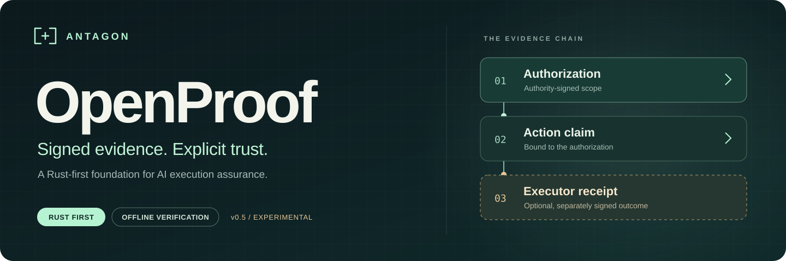

<p align="center">
  
</p>

# Antagon OpenProof

**Rust-first evidence for AI actions. Signed approvals. Execution receipts. Offline verification.**

OpenProof connects an exact authorization to a bounded action, a receiver's execution receipt, and a witness checkpoint. It helps an owner answer: **What did I approve? What was reported as executed? Does the evidence agree?**

<p>
  <a href="#quick-start"><strong>Quick start</strong></a> &nbsp;·&nbsp;
  <a href="#what-openproof-guarantees">Guarantees</a> &nbsp;·&nbsp;
  <a href="docs/TCB.md">Trusted code</a> &nbsp;·&nbsp;
  <a href="#what-the-evidence-means">Trust boundaries</a> &nbsp;·&nbsp;
  <a href="docs/VALIDATION.md">Validation</a> &nbsp;·&nbsp;
  <a href="docs/ROADMAP.md">Roadmap</a>
</p>

> **v0.9.0 · Experimental · No production-security claim**
> Signatures authenticate statements. They do not prove that a model is truthful, a physical-world effect occurred, or an operator is independent. The current milestone has not received a human security audit.

## What OpenProof guarantees

OpenProof makes three guarantees, each with a stated condition. [docs/TCB.md](docs/TCB.md) lists the code each one depends on.

| | Guarantee | Holds today when |
|---|---|---|
| **G1** | A document changes only for the exact content, version and receiver that the owner approved, once, before the approval expires. | A passkey is set up: every approval then needs a fresh Touch ID (or other user-verified) gesture on a key no host process can read ([PASSKEY.md](docs/PASSKEY.md)). The receiver runs under its own account, so owner processes cannot change its state directly ([LOCAL-ROLES.md](docs/LOCAL-ROLES.md)). Without a passkey, the approval key is a file on the host. |
| **G2** | Every executed change is in the witness's signed, ordered history. Omission, reordering or a fork is detected against a trusted checkpoint. | The witness is run by a party other than the receiver. Separate role accounts are a step toward this, not the full condition. |
| **G3** | Anyone can verify an exported history offline with the separate Go verifier, given the trusted root and a current checkpoint. | The verifier and root are obtained independently of the archive. |

## The one path

**Propose → review → approve with passkey → execute → witness → verify offline.**

1. An agent **proposes** a document change through the MCP tools. Agent tools can propose and execute approved work. They cannot approve.
2. The owner **reviews** the exact content and its SHA-256 in the local owner app and **approves** it with a passkey. The passkey signs the approval digest, so the gesture is bound to that exact document, version, content and nonce.
3. The owner separately **executes**. The receiver checks the approval and the passkey assertion, applies the change atomically and signs a receipt. A retry returns the original receipt without a second change.
4. The **witness** adds the receipt to its ordered history and signs a checkpoint.
5. The owner **exports** the history. Anyone **verifies** it offline with the Go verifier.

The owner app renders model-provided text as text, never as commands or executable HTML. Interrupted actions are recovered without dispatching unexecuted work.

Experimental features are outside the guarantees and outside the first audit scope: planned key handover, the S3 storage pilot, remote mTLS role services and certificate lifecycle, archive retention, and the isolated report agent. See [docs/TCB.md](docs/TCB.md#outside-the-trusted-code).

## Quick start

Use macOS or Linux with Rust/Cargo, Python 3.11 and Go installed. The repeatable CI configuration pins Rust **1.92.0** and Go **1.27.3**. Docker is needed only for container experiments.

```sh
git clone https://github.com/antagoninc/openproof.git
cd openproof

python3 scripts/quickstart.py
```

The first-run command installs the pinned Python dependencies in a project-local environment, builds Rust and Go, runs eight synthetic assurance experiments, opens their interactive results, and starts a fresh owner workspace with an unapproved sample. No Docker or model account is needed. Use `--check --no-open` for a noninteractive check.

On macOS, after setup, double-click **[Open OpenProof.command](Open%20OpenProof.command)**. The app uses a private local home under `outputs/owner-home` and listens only on loopback. Keep the terminal open while using it; Control-C stops the app. No external model call is made by startup or fixture demonstrations.

For a synthetic command-line demonstration:

```sh
outputs/local-venv/bin/python scripts/witness_demo.py --out outputs/my-demo
```

Choose a new output directory for each demonstration. These examples simulate approval of public test content; they are not evidence of human approval of a real action.

**[Owner guide →](docs/OWNER-APP.md)** · [Agent/MCP workflow](docs/WITNESSED-WORKFLOW.md) · [Authenticated services](docs/AUTHENTICATED-SERVICES.md)

## Explore and verify

The first-run experiment explorer shows altered content, substituted signers, duplicate receipts and omitted history rejected by real checks. An identical approved retry recovers the original receipt without another update. These are simulated approvals, not human consent.

Evidence exports include a readable, script-free `viewer.html` and `VERIFY.txt`. The viewer is explicitly **unverified display**. Use your independently obtained Go verifier and separately trusted genesis root and current checkpoint to generate a fresh offline result:

```sh
outputs/local-venv/bin/python scripts/verify_history.py EXTRACTED_ARCHIVE \
  --root TRUSTED_GENESIS_ROOT_HEX --checkpoint SEPARATELY_TRUSTED_CHECKPOINT.json \
  --go-binary outputs/tooling/openproof-go-verify --out outputs/my-offline-check
```

[Storage pilot](docs/STORAGE-PILOT.md) · [Archive retention](docs/ARCHIVAL.md) · [TRACE comparison scope](docs/COMPARISON.md) · [Daily operations and measurements](docs/OPERATIONS.md) · [Compatibility policy](docs/COMPATIBILITY.md) · [Controlled preview checklist](docs/RELEASE-CHECKLIST.md)

## What the evidence means

| Result | Supported interpretation | Not established |
|---|---|---|
| Valid approval | The configured authority signed the exact scoped request | Good intent or a safe policy |
| Receiver receipt | The receiver signed a statement about its stored document update | Arbitrary external or physical effects |
| Matching witness checkpoint | The signed history matches the supplied checkpoint | Independent administration or honest signers |
| Complete verified history | Required receipts/approvals connect under the selected trust and checkpoint | Protection when the caller also rolls back its trusted anchors |
| Disclosed gap | The verifier identifies incomplete knowledge | Complete execution history |

The owner UI, receiver and witness can run under one host account. That arrangement is useful for development, but it is **not independent custody**. Docker containers still share a host administrator. The service client can operate without root/receiver/witness private keys; separately administered infrastructure still requires actual operators and deployment work.

The Go verifier is separately implemented without calling Rust, but it shares project authorship. It is not an external audit. Its archive mode requires a separately trusted root, a current checkpoint and the actual current time. Planned migration is not compromised-key recovery.

## Validation

The recorded v0.9 local milestone passed (the current branch adds passkey approvals; its local run on 8 Nov 2026 passed 141 Rust tests (145 with experimental features), the Go tests, 218 Go/Rust cross-implementation cases, 83 Python tests and both browser workflows on Linux):

| Check | Recorded result |
|---|---|
| Rust workspace | **117 tests** on macOS and Linux |
| Python workflows and boundaries | **57 tests** |
| Cross-implementation cases | **520 cases** across evidence, trust and witness suites |
| Browser workflow | Desktop and mobile review, approval, execution and retry |
| Bounded fuzz campaigns | **4,390,141 executions**; the new stateful target covered only **78 sequences** |
| Repeat Linux build | Identical witness executable bytes on the same host and pinned image |

The initial private import also passed [Linux and macOS hosted validation](https://github.com/antagoninc/openproof/actions/runs/42453339807). That run covers its recorded commit; later changes require fresh validation. The [sanitized validation summary](docs/VALIDATION.md) explains scope and limitations. Generated logs, private keys, databases, browser sessions and runtime homes are deliberately excluded from Git.

To run the complete validation, install `cargo-audit` and use a fresh directory:

```sh
cargo install cargo-audit --version 0.22.2 --locked
outputs/local-venv/bin/python scripts/validate.py --out outputs/my-validation
```

The workflow performs checks and builds only. It does not publish packages, upload runtime artifacts or create a release. See the [build guide](docs/BUILD.md).

## Project map

| Path | Purpose | In the trusted code |
|---|---|---|
| `crates/openproof-core` | OPEC-1 canonical bytes, domain-separated signatures, strict parsing | Yes |
| `crates/openproof-witness` | Document receiver, witness, passkey check, pages, history verifier | Yes, except `rotation.rs` and `storage.rs` |
| `reference/go-witness` | Separate Go verifier of exported histories | Yes (G3) |
| `app`, `scripts/owner_app.py`, `scripts/witness_workflow.py`, `scripts/witness_mcp.py` | Owner app, broker and agent tools | Yes (G1) |
| `crates/openproof-runtime`, `crates/openproof-trust`, `crates/openproof-cli` | Original v1 action bundles | No; kept for compatibility |
| other `scripts`, `isolation`, `deployment` | Experiments, demonstrations, validation | No |
| `schemas` / `fixtures` / `fuzz` | Versioned formats, public synthetic evidence and fuzz targets | Test material |

## Documentation

[Trusted code](docs/TCB.md) · [Passkey approvals](docs/PASSKEY.md) · [Protocol](docs/PROTOCOL.md) · [Threat model](docs/threatmodel.md) · [Security policy](SECURITY.md) · [Recovery](docs/RECOVERY.md) · [Trust](docs/TRUST.md) · [Operator handoff](docs/handoff/OPERATORS.md) · [Human review brief](docs/handoff/REVIEW-BRIEF.md) · [Roadmap](docs/ROADMAP.md)

Some historical guides mention `outputs/...` records from the local development workspace. Those paths are not distributed evidence; use the sanitized validation summary for repository-readable results or regenerate fixtures locally.

## Contributing and licensing

See [CONTRIBUTING.md](CONTRIBUTING.md). Protocol changes need a versioning decision, byte vectors, negative tests and explicit trust assumptions.

Eligible project source is licensed under **[Apache-2.0](LICENSE)**; dependencies retain their own licenses. Read the [IP boundaries](docs/IP-BOUNDARIES.md). Proprietary Antagon code, models, datasets and credentials do not belong in this repository. Antagon branding is not a grant of trademark rights.

OpenProof is independently authored. No TRACE compatibility, code reuse or security superiority is claimed. Public visibility and release publication require separate owner approval.
