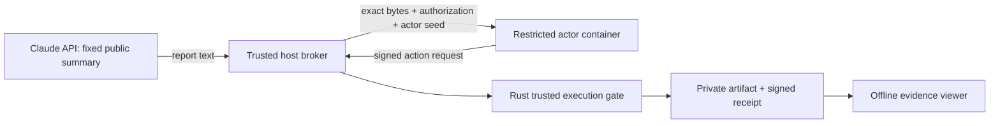

# Claude report → isolated actor → trusted execution

> This page describes the v0.5 demonstration. For the v0.6 interactive approval path, confirmed cleanup, explicit seccomp checks and portable evidence, use [Daily workflow](DAILY-WORKFLOW.md).

v0.5 provides one deliberately bounded integration. The trusted host adapter asks Claude for a short report using a fixed, public project summary. It sends no repository files, keys, models or proprietary material. It receives plain text, then applies a fixed report policy: at most 8 KiB, `artifact.write`, and the fixed `urn:openproof:artifact` resource. The host authority signs the exact bytes. This is automatic approval under that narrow demo policy, not a human-review prompt or a general tool dispatcher.

A separate actor container receives the proposed bytes, signed authorization and only its own ephemeral actor seed via stdin. It signs an action request. The host invokes the Rust trusted execution gate, which enforces exact policy/argument binding, trust, time and replay checks before writing a new private artifact. The host verifies the signed receipt and saved bytes, then returns the public evidence and output to a fresh isolated actor process for independent Python verification and an acknowledgement. Claude is called only to generate the report; the local actor receives the receipt. The API key, root/authority keys, executor seed and replay database are never mounted into or sent to the worker.



## Run locally

Use a local Docker engine over a Unix socket. The runner rejects remote endpoints. No source directory, home directory or Docker socket is mounted into the actor.

```sh
python3 -m venv outputs/agent-venv
outputs/agent-venv/bin/pip install -r scripts/requirements.txt jsonschema==4.25.1
cargo build --workspace --locked
outputs/agent-venv/bin/python scripts/build_isolation.py --out outputs/worker-build

# No model call, credentials or API charge:
outputs/agent-venv/bin/python scripts/isolated_agent.py \
  --provider fixture --image-id-file outputs/worker-build/image-id --out outputs/offline-run

# Configure ANTHROPIC_API_KEY in your local environment, never a project file or chat.
# This makes one bounded paid request to the fixed Claude Messages endpoint.
outputs/agent-venv/bin/python scripts/isolated_agent.py \
  --provider claude --image-id-file outputs/worker-build/image-id --out outputs/claude-run
```

All output directories must be new. `--model` selects another accessible Claude model; the default is `claude-haiku-5-5`. The API adapter sets `max_tokens=1024`, uses a 60-second timeout, disables redirects and ambient proxies, verifies TLS with a pinned certifi bundle and never automatically retries. No tools, conversation history or local file content are sent. A missing credential, connection failure, truncated response or excessive output fails before authorization or execution. Error logs omit request headers and API response bodies. The initial live test used the host's existing certificate bundle; the final reproducible setup pins certifi 2026.10.23.

The adapter follows [Claude Messages](https://platform.claude.com/docs/en/api/messages/create) and [model IDs](https://platform.claude.com/docs/en/models/overview), checked 7 November 2026. These service capabilities may change. The local record stores returned model, request ID, token usage and prompt/report hashes. This metadata is a host observation, not model-service cryptographic attestation.

## Enforced worker configuration

| Control | Configuration |
|---|---|
| Identity | UID:GID 65532:65532 |
| Host mounts | None, including no Docker socket |
| Network | None |
| Root filesystem | Read-only |
| Capabilities | All dropped; no new privileges; Docker default seccomp retained |
| Resources | 128 MiB RAM and equal swap limit, one CPU, 32 processes, no shared IPC |
| Input/output | Bounded stdin; 64 KiB maximum on each output stream; 30-second execution deadline |
| Cleanup | Worker removed after success or failure; ephemeral executor seed removed in finally |

The broker inspects actual Docker settings before dispatch. Probes attempt host-canary, executor-file, replay-database and Docker-socket reads; filesystem writes; root escalation; and outbound connectivity. Adversarial requests attempt a new destination, changed bytes, expired authorization, replay and modified output. A worker output flood exercises the host-side output cap. These are bounded regression tests, not proof against container/kernel escapes.

Docker and its VM/daemon, the host broker, host account, Python/runtime libraries, trusted keys and state remain trusted. The worker is a signing wrapper around externally generated report text, not a model running inside the container or a general autonomous tool agent. The local executor remains limited to its existing artifact adapters. The broker is not a public network service. The demonstration uses ephemeral keys; production key custody and a long-lived authority service are future work. No API key is passed into Docker, but the trusted host environment necessarily contains it.

## Evidence viewer

Open `viewer.html` from a completed run. It shows authorized operation, executor statement, artifact match, report text and expandable raw evidence. Rendering independently verifies trust/signatures and output bytes through the Python verifier; it never trusts `checks.json` as a verification result. It confines artifact reads to the run's jobs directory, rejects symlink/path escapes, caps input, escapes HTML and includes no JavaScript or external resources.

```sh
outputs/agent-venv/bin/python scripts/render_evidence.py outputs/claude-run --out outputs/rechecked.html
```

The view is a static verification snapshot with a displayed time, not live monitoring. A locally supplied anchor is not an independent identity certificate. The demo trust snapshot expires after one hour; later re-rendering correctly fails freshness unless the operator supplies appropriately fresh trusted material. Do not interpret an old green HTML page as current verification. Signed receipts do not establish report truth or externally witnessed effects.
